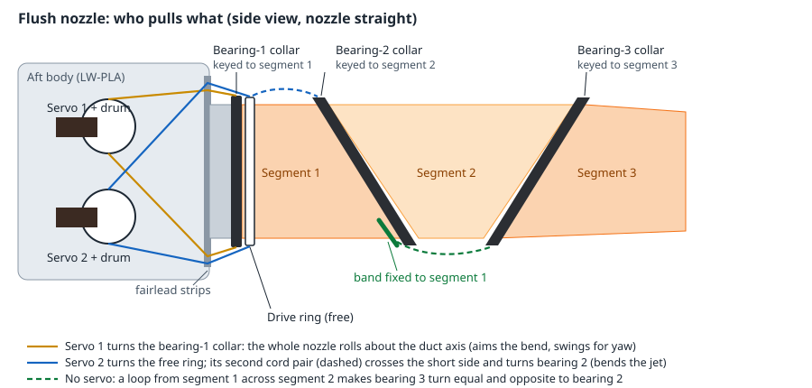

# Ducted main fan and swivel nozzle: DIY bench kit

Status: first design, **nothing printed or run**. The numbers below are estimates from
fan scaling laws and momentum theory. The point of the kit is to replace them with
measurements before the airframe is redesigned around it.

Interactive model: `/nozzle.html` on the site. CAD: `cad/propulsion.py`.
Nozzle maths: `site/js/nozzle.js`, checked by `node tools/nozzle-test.mjs`. Loads on the
nozzle: `site/js/nozzle-loads.js`, checked by `node tools/nozzle-loads.mjs`. Flight-controller
code: `firmware/nozzle/`, checked by `node tools/nozzle-firmware-test.mjs`. `npm test` runs all four.

## Why 80 mm, and why only the main fan

| Fact | Consequence |
|---|---|
| Fan thrust goes with speed squared and diameter to the fourth power | A small fan needs very high speed |
| Bought 70 mm fans turn 33,000-40,000 rpm | They use 2,700-3,500 KV motors |
| The EMAX 2306 1700KV on 4 cells turns about 18,000-20,000 rpm under load | A 70 mm fan on it would give roughly 0.5 kg: too little |
| The same motor on an 80 mm fan | Roughly 0.85 kg at about 30 A (450 W) |
| A three-bearing nozzle bent 90 degrees | Costs perhaps 15% of that |
| The lift fan already sits in a duct in the body, and the roll motors in ducts in the wings | Only the main motor needs a new fan to get the F-35B look at the tail |

So the kit is one printed 80 mm fan for a motor you own, plus the nozzle.

## What is in the kit

| Part | Qty | Est. g | Notes |
|---|---|---|---|
| `edf_impeller` | 1 + spares | 36 | 7 blades, clamps on the motor's M5 shaft with the propeller nut |
| `edf_duct` | 1 | 59 | Shroud, 45 degree bellmouth, 6 cambered stator vanes and one straight wire vane, motor plate, first bearing flange |
| `edf_tail_cone` | 1 | 4.5 | Push fit behind the motor plate; a thin 64 mm cone that reaches into segment 1 |
| `nozzle_segment_1/2/3` | 1 each | 40 / 40 / 21 | Plain tubes with a flange each end. Segment 1 also has a sleeve for the drive ring, four cord posts and a cord band; segment 2 has two cord posts |
| `bearing_collar_half` | 4 | 5 | Clamp bearings 2 and 3; zip tie in the middle groove. Also cord pulleys |
| `bearing_collar_half_j1` | 2 | 4 | Clamp bearing 1. Also servo 1's pulley |
| `nozzle_drive_ring` | 1 | 6 | Free ring behind bearing 1, turned by servo 2 |
| `servo_cord_drum` | 2 | 8 | 55 mm cord drum on each servo horn; pocketed underneath to pay for the washers |
| `seal_washer` / `seal_washer_j1` | 4 / 2 | 0.7 / 0.6 | **Cut, not printed**, from 0.25 mm PTFE sheet. `cad/dxf/` has the outlines |
| `cord_fairlead_right/left` (in `cad/build.py`) | 1 each | 2 | Hard strip in the rear face of the body where the cords turn the corner |

Bought: 1 x EMAX 2306 (owned), 2 x MG90S (owned), about 3 m of 0.5 mm braided PE
(Dyneema) fishing line, 6 zip ties, 4 x M3 x 6 screws, silicone grease, a 100 x 100 mm
piece of 0.25 mm PTFE sheet (about $5), 12 mm PTFE thread-seal tape, and offcuts of PTFE
tube (the 2 mm bore printer kind) to line the fairlead holes. The PTFE parts are no longer
optional: see "Can two MG90S hold it?" below.

Printed mass is about 275 g; with motor and servos about 340 g.

## How the nozzle works

Three bearings in series. Bearing 1 is square to the duct. Bearings 2 and 3 are canted
40 degrees in opposite directions. Turning 2 and 3 by equal and opposite angles `b`
bends the jet by `4 * asin(sin(40) * sin(b / 2))`. Bearing 1 then turns the whole bend
to point straight down, and a little either side of that to swing the jet for yaw.

| Deflection | Bearing 1 | Bearings 2 / 3 | Servo 1 | Servo 2 |
|---|---|---|---|---|
| 0 (straight aft) | -90 | 0 / 0 | +26 | -44 |
| 45 | -104 | 35 / -35 | +2 | 0 |
| 90 (straight down) | -120 | 73 / -73 | -26 | +44 |
| 100 (braking) | -124 | 82 / -82 | -33 | +54 |

Servo angles are from each servo's centre, with no yaw. Full yaw adds up to 37 degrees
to both. The largest swing anywhere is +/-81 degrees, inside an ordinary servo's +/-85.

## Flush drive: cords, not gears

The first version had a servo and a 52 mm gear standing on each bearing, about 180 mm
across. That cannot be made flush: an ordinary servo turns about 170 degrees and each
bearing about 80, so the gear on the servo must be half the size of the ring it drives.

Now nothing rides on the nozzle. It is 109 mm across at its widest ring, against a
102 mm nacelle.



| Who | Pulls | Through | Result |
|---|---|---|---|
| Servo 1 (right side of the body) | Bearing-1 collar, which is keyed to segment 1 | 2 cords: one over the top of the collar, one under | Rolls the whole nozzle about the duct axis: aims the bend down, swings it for yaw |
| Servo 2 (left side) | A free ring just behind bearing 1 | 2 cords, same pattern | Turns the ring |
| The ring | Bearing-2 collar, keyed to segment 2 | 2 cords crossing the short side of segment 1, through 4 posts | Bends the jet |
| Segment 1 (a band on its long side) | Bearing-3 collar, keyed to segment 3 | 2 cords through the bumps on the bearing-2 collar and 2 posts on segment 2 | Bearing 3 turns equal and opposite to bearing 2. No servo |

Three facts make this work:

1. **Bearings 2 and 3 always turn by equal and opposite angles.** So one can drive the
   other. Seen from segment 2, segment 1 and segment 3 turn the same way by the same
   amount; a cord loop between two pulleys of the same radius (53.4 mm) enforces that.
2. **A collar is a free ring until it is keyed.** Each collar now has a notch that
   catches a rib behind the flange of the part downstream of it, so it turns with that
   part and can serve as its pulley.
3. **The ring's position is a + 1.07 x b** (bearing-1 angle plus 1.07 times bearing-2
   angle; 1.07 is the ratio of the two pulley radii). The flight controller works that
   out; it is one line in `servoAngles()`.

Each servo stands on edge in a pocket beside the fan duct, open to the belly, with its
55 mm drum already on it. The cords leave the drum top and bottom, run aft inside the
body, and turn the corner at a PETG fairlead strip in the body's rear face.

**Stringing it** (do this on the bench, nozzle off the aircraft, before fitting):

1. Every bearing turns freely by hand with the collar zip-tied. Fix that first.
2. Slave loop: nozzle straight. Knot one cord through the hole at each end of the band
   on segment 1, lead each through its bump on the bearing-2 collar and its post on
   segment 2, half a turn round the bearing-3 collar's front groove, and knot in a slit.
   Turn bearing 2 by hand: bearing 3 must mirror it over the whole 82 degrees.
3. Ring to bearing 2: same idea, from the ring's rear groove through the posts on
   segment 1 to the bearing-2 collar's front groove.
4. Fit the nozzle. Centre both servos. String servo 1 to the bearing-1 collar and
   servo 2 to the ring's front groove with the nozzle at 45 degrees (both servos are
   near centre there).
5. Take up slack with the knots. Cords should be snug, not guitar-string tight.

The same `solve()` function goes into the flight controller: two inputs (deflection,
yaw), two servo outputs.

## Can two MG90S hold it?

This was not checked when the cord drive was drawn. It is now (`site/js/nozzle-loads.js`), and
the answer for the drawing as it was is **no**.

The jet does not just push the aircraft; it also tries to unbend the nozzle. The flow enters each
bearing along the axis of the part upstream, so it has no lever there, but it leaves at the exit, and
that line misses the axis of bearing 2. At 90 degrees and full thrust (958 g) that is 0.31 N m
(3.2 kg cm) on bearing 2 before any friction. The bearings also carry up to 9 N along the duct, 11 N
across it and 1 N m of tilting moment, and plain printed flanges turn that into friction.

Torque each servo has to hold, kg cm, worst of yaw left, centre and right:

| Deflection | 0 | 30 | 45 | 60 | 90 | 100 |
|---|---|---|---|---|---|---|
| Full thrust, PETG on PETG (as drawn) | 1.0 | 4.2 | 6.4 | 8.3 | 10.9 | 11.6 |
| Full thrust, with PTFE | 0.4 | 1.6 | 2.5 | 3.2 | 4.1 | 4.3 |
| Hover thrust (263 g), PETG on PETG | 1.0 | 0.7 | 1.3 | 1.9 | 2.7 | 2.9 |
| Hover thrust, with PTFE | 0.4 | 0.2 | 0.5 | 0.7 | 1.0 | 1.1 |

An MG90S stalls at about 2.2 kg cm on 6 V (1.9 on 5 V). We allow the nozzle 70% of that, 1.54 kg cm,
so the servo is never parked near stall. In the simulated transition and back (`tools/sim-test.mjs`)
the drawn design needs up to 3.8 kg cm and is over budget 72% of the time: the jet would have
straightened the nozzle and pitched the aircraft. Three changes fix it, with no weight added:

1. **PTFE on every sliding face.** A washer between the flange faces and one behind the upstream
   flange at each bearing, PTFE tape in the collar bore, PTFE tube in the fairlead holes. Friction
   coefficient about 0.08 instead of 0.20; cord friction about 0.10 instead of 0.25.
2. **Servo rail at 6 V**, not 5 V: 15% more torque for nothing. The regulator must be the adjustable kind.
3. **The controller caps the main fan by deflection** so the jet never asks for more than the servos
   have. The cap is in `firmware/nozzle/NozzleLimits.h`, written from the model:

| Deflection | 0-15 | 30 | 45 | 60 | 75 | 90 | 100 |
|---|---|---|---|---|---|---|---|
| Most main-fan thrust the nozzle can hold, g | 958 | 909 | 630 | 496 | 422 | 380 | 364 |

The hover needs about 263 g from the main fan at 90 degrees, so the cap leaves 44% for pitch control. With all
three, the simulated transition peaks at 1.43 kg cm, inside the 1.54 budget, and still passes every
flight check. The cap barely acts in that run.

That margin is thin, and it rests on the friction coefficients, which are guesses. Bench step 6
below measures them. If the measured torque is higher, the next step is a stronger servo in the
same pocket, such as the Hitec HS-5087MH (about 4.3 kg cm on 7.4 V). It weighs about 22 g against
13 g, though, so a pair costs 17 g that the 2,000 g target does not currently have.

Things that do not help: shortening segment 3 (the torque does not depend on it), or a bigger drum
(the servos already use 81 of their 85 degrees each way).

## Where the thrust goes

Compared with the reference build's nozzle (frames from its bench video), and measured on our CAD:
the bore was cut in 0.2 mm slices along the flow with the nozzle straight.

| Loss | Before | Now | Estimate |
|---|---|---|---|
| **Two 45-degree mitred joints** when bent 90 degrees | 15% assumed | 25% assumed | Handbook loss for a sharp 45-degree mitre is about 0.25-0.3 of the duct's dynamic pressure each; two of them, 1.3 diameters apart, about 0.5. With the exit converging 80 to 74 mm that is 20-30% of thrust. Every three-bearing nozzle has it; the reference's does too. Only the thrust stand will say |
| **Fan swirl** | 5 flat vanes, square to the duct | 6 cambered vanes and a straight wire vane | The rotor leaves the air turning at 17 degrees at the tip and 36 at the hub (free vortex from `analysis/fan_bem.py`); about 16% of the jet's energy is in that spin. Flat vanes meet it at up to 36 degrees and stall. Cambered vanes meet it head-on and turn it straight. Likely 4-6% more thrust, in every pose |
| **Tail cone** | 30 mm long, about 30-degree taper | 64 mm, about 17 degrees, reaching into segment 1 (which only ever turns about its own axis) | The short cone would have shed a wake the width of the motor. 1-3% |
| **Bore shape near the canted bearings** | Area swung 92% to 116% to 84%, with an 11.8 mm dip in the wall | 95% to 110% to 83%, dip 9.3 mm | The tilted neck under each collar was 10 mm long; now 6 mm, just the collar. The rest of the dip is geometry: a 91 mm round bearing on a 40-degree cut through an 81 mm bore must pinch the bore top and bottom. Removing it needs a 106 mm bearing, which would not fit between the tail booms. About 1-2% |
| **Leaks at the bearings** | 0.5 mm play, no seal | Spigot and PTFE washer | About 3%, see Sealing |

The weight went down: duct 2 g, tail cone 3.6 g, segments 1.4 g. The aircraft is now 1,983 g and
the hardest-working hover fan 59.7%. Raising the bend loss from 15% to 25% does not change the
hover limit; the main fan works a little harder at 90 degrees (263 g instead of 237 g), still well inside
the servo cap.

What the reference does differently, from its video: gear rings with a small servo riding on each
segment (not flush, but stiff); bearing rings bolted together with many screws, probably ball races;
long, plain segments; and a convergent petal exit. Its controller settings show a 90-degree angle
limit, a 10-degree yaw limit, a slew of 15 deg/s and a "homing torque", which suggests its servos run
with a torque limit. Our yaw limit is 20 degrees and our slew 150 deg/s; if the bench shows the
cords slipping or overshooting, these are the first two numbers to bring down.

Further gains, not done: a smoother, sanded or epoxy-coated bore (print the segments standing up so
the layer lines run round the bore, not across the flow), and a petal exit like the reference's,
which is mostly looks.

## Sealing

Each bearing is two flanges clamped in a collar. Before this change the faces had 0.5 mm of play
and nothing in the gap. The static pressure inside the nozzle is only about 300 Pa at full thrust (the
exit converges from 80 to 74 mm), so the leak is small but real: about 1% of the flow per bearing,
roughly 3% of thrust over three bearings. The play was also slack that the cords would have to take
up on every reversal.

- **Spigot and counterbore.** The downstream part has a 2 mm lip, 0.9 mm thick, the same bore as the
  duct, that turns inside a counterbore in the upstream flange with 0.4 mm clearance. The joint is
  behind a step, out of the jet, and air has to turn twice to escape. The bore stays smooth.
- **PTFE washers.** One 0.25 mm washer between the flange faces closes the gap; a second, behind the
  upstream flange, takes up the remaining play. The collar slot is now 0.6 mm wider than the two
  flanges, so two washers leave 0.1 mm of running clearance. Silicone grease on both sides.

Cut the washers with a craft knife round a template (print the washer STL), a vinyl cutter, or a laser (the DXF
files are in `cad/dxf/`). The seal adds 4 g; the pocket under each servo drum takes 4.2 g off.

## Controller

Two ports of the same code, so it does not matter which flight controller wins
(`docs/engineering/05-ardupilot-sitl-plan.md`). Both are checked against `site/js/nozzle.js` by
`tools/nozzle-firmware-test.mjs`.

- `firmware/nozzle/Nozzle3BSM.h`: C++, no Arduino calls, for the ESP32 and madflight.
- `firmware/nozzle/nozzle_3bsm.lua`: ArduPilot script. Reads the tilt and rudder outputs, writes two
  servo pulses on the Script 1 and Script 2 functions. Its input scaling must be confirmed in SITL.

What it does every loop, in order:

1. **Radio lost:** hold the last deflection and centre the yaw.
2. **Hover guard:** while airborne below 6 m/s, keep at least 35 degrees of deflection, fading out by
   17 m/s (same as `site/js/sim.js`). Nothing aft of the balance point holds the tail up otherwise.
3. **Rate limit:** 150 deg/s of deflection and 300 deg/s of yaw. At power-up it assumes the stringing
   pose (45 degrees) and moves off it at 30 deg/s, so a badly strung nozzle cannot snap a cord.
4. **Solve** the three bearing angles and the two servo angles.
5. **Backlash:** when a drum reverses, it overshoots by half the measured slack so the other cord
   takes the load straight away.
6. **Pulses:** centre trim and direction for each servo, clamped to 500-2,500 us.
7. **Thrust cap:** returns the most main-fan thrust the nozzle can hold at the deflection it has
   reached. The mixer clamps the main motor to it. `site/js/sim.js` does the same.

In the madflight loop it is three lines:

```cpp
#include "Nozzle3BSM.h"
nozzle::Nozzle nz;                                   // once
auto o = nz.update(dt, tiltCmd, yawCmd, airspeed, onGround, rcOk);
servo1.writeMicroseconds(o.us[0]); servo2.writeMicroseconds(o.us[1]);
mainThrust = fminf(mainThrust, o.thrustCap * MAIN_MAX);
```

## Test plan (the gate before any airframe change)

1. **Print one bearing pair first** (the rear of `nozzle_segment_1`, the front of
   `nozzle_segment_2`, two collar halves): check it turns freely with grease.
2. **Print the impeller.** Balance it on the motor shaft: spin by hand, mark the heavy
   side, sand the blade tips of that side.
3. **Fan alone on the thrust stand.** Duct zip-tied to the wood block, exhaust clear.
   Step the throttle 30 / 50 / 70 / 100% and log grams and amps.
4. **Add the nozzle straight**, repeat. Then at 45 and 90 degrees with the scale turned
   to read the right direction.
5. **Decide on thrust** (table below). The airframe needs about 450 g from the nozzle at 90 degrees for hover
   at about 60% throttle. Below 550 g at full throttle through the bent nozzle, this
   route does not carry the aircraft with this motor.

| Result at full throttle, nozzle at 90 degrees | Decision |
|---|---|
| 700 g or more | Integrate as designed |
| 550-700 g | Integrate, but shift more lift to the front fan and roll pair |
| Under 550 g | Change the blade pitch or count and retest; if still short, a higher-KV motor on 70 mm, or stay with the open propeller |

6. **Measure what the servos have to hold** (the model's friction numbers are guesses). Nozzle
   strung and on the stand, fan off. Hook a luggage scale on the cord at a servo drum and pull until
   the drum turns: grams x 2.75 / 1000 is kg cm (the drum radius is 2.75 cm). Do it at 0, 45 and 90 degrees, then again with the fan
   at the hover setting (about 25% of full thrust at 90 degrees). Anything over 1.5 kg cm means the
   friction is higher than modelled: check the washers, then consider the stronger servo.
7. **Measure the slack.** Command 45 degrees from above, then from below, and read the exit angle
   each time with a phone inclinometer on segment 3. Half the difference, turned into servo degrees,
   goes in `backlashDeg`. More than 3 degrees of exit difference: retension the cords first.

## Risks, plainly

- **Blade loss.** A printed blade at 18,000 rpm carries roughly 9 MPa at the root. PETG
  can take it with margin if the layers bond well, but a bad print can shed a blade.
  Run behind a board, wear eye protection, never stand in line with the fan disc.
- **Motor heat.** 30 A continuous in a closed hub with no airflow over the bell is
  harder on the motor than an open propeller. Check temperature after 30 s runs.
- **Thrust may fall short.** Printed fans are usually less efficient than moulded ones.
- **Weight at the tail** moves the balance point aft. The battery can no longer slide to
  compensate, so integration will need the nozzle as short and thin as tests allow.
- **Cord drive is the least proven part.** It has been drawn, checked for clashes and now
  for load (see "Can two MG90S hold it?"), but not strung. The margin over the servos is
  about 3%, on guessed friction. Open questions for the bench: friction where each cord turns 90 degrees
  at the fairlead (an MG90S should leave roughly 2.5 kg cm at the bearing after that
  loss; the gears gave about 4); stretch and backlash in about 3 m of line; whether the
  cords stay in 1.4 mm grooves where they cross from one pulley to the next at an angle.
  Likely first fixes: PTFE-lined fairleads, deeper grooves, a spring in each cord pair.
- **A cord failure bends or straightens the nozzle uncommanded.** In the hover that is
  a pitch upset the lift fan cannot fully correct. Fly it tethered first.

## Integrated into the airframe (drawn ahead of the thrust test)

The twin and the CAD now show the aircraft with the ducted main fan and nozzle fitted.
This was drawn before any measurement at the owner's request; if the thrust test
fails, the aft fuselage goes back to the open-propeller version in git history.

- **Engine nacelle.** A round nacelle on the aft bridge holds the fan duct, which slides
  in from the rear.
- **Air inlet.** The rear 36 mm of the centre section is open above and below, between
  the bay and the fan. The dorsal opening is where the real aircraft has its auxiliary
  inlet doors.
- **Nozzle between the booms.** Checked by script in 15 poses (deflection 0 to 100
  degrees, yaw left, centre and right): no clash with booms, fins, tailplanes or ground.
  The yaw swing is tapered from 20 to 8 degrees past 90 degrees deflection to keep that
  true. The nozzle is flush: 82 mm half-width at its widest, inside the 84 mm gap.
- **Nozzle servos inside the body.** Two pockets in the aft bridge, one each side of the
  fan duct, open to the belly. The nacelle grew from 94 to 102 mm so the first bearing
  ring sits flush with it.
- **Taller skids.** The nozzle hangs 140 mm below the datum when it points down, so the
  ground line moved from 85 to 150 mm below the datum.
- **Tilt mount deleted:** two bearings, yoke, cradle and two servos gone; two nozzle
  servos, two drums, a drive ring and three collars added.
- **Speed controllers** now stand on edge against the bay side walls, because the bay
  lost its rear 26 mm to the inlet.
- **Controller behaviour.** With the nozzle straight, nothing aft of the balance point
  can hold the tail up. The flight controller therefore keeps the nozzle at least 35
  degrees down until the wing is flying (fully below 6 m/s, fading out by 17 m/s), whatever
  the pilot asks for. See "Controller".

### Lift fan

`lift_fan_rotor` is a 120 mm, 9-blade rotor on the existing spider and motor, a mirror
image of the main fan so the two torques oppose. It is sized by motor torque: about
20 A in the hover at 13,500 rpm, an estimated 1.3 kg at 30 A. `lift_fan_ring` is a hard
PETG shroud pressed into the fan bay so the 0.6 mm tip gap does not depend on the soft
LW-PLA body. Test it on the thrust stand the same way as the main fan.

### Estimated numbers for the integrated aircraft

| Quantity | Value |
|---|---|
| All-up weight | about 1,890 g (was 1,575 g with open propellers) |
| Balance point | 82 mm behind the datum (was 70 mm) |
| Usable thrust / weight | about 1.60 |
| Hover load: lift fan / main fan / each roll motor | 60% / 64% / 64% of estimated maximum |

These margins are thin and rest on three unmeasured thrust figures (1,300 g lift fan,
850 g main fan, 500 g per roll motor) and a guessed 15% nozzle loss.
